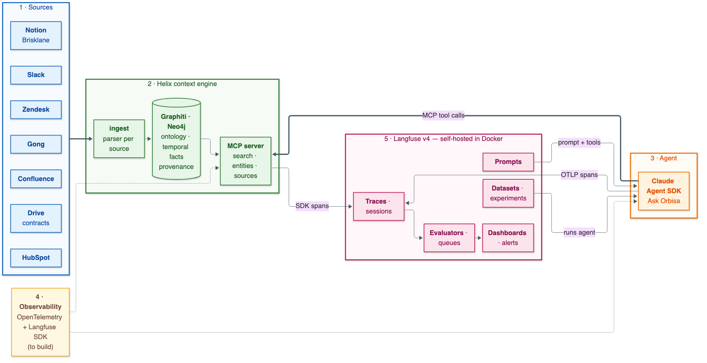

# Orbisa — make Helix observable

You are joining the engineering team at **Orbisa**, a logistics SaaS company whose knowledge is spread
across seven systems. The team already built **Helix**, a context engine that turns those systems into a
temporal knowledge graph served over MCP, and **Ask Orbisa**, an agent that answers employees' questions
from it. Nobody can tell yet whether the answers are right, why, or what they cost.

**Start here:** [`docs/orbisa-case-study.pdf`](docs/orbisa-case-study.pdf), the engineering brief.
Then follow the team session in [`prompts/`](prompts/README.md).

> Orbisa, Brisklane, Helix and every person and number in this repo are fictional.



## Run everything in Docker

Requirements: Docker Desktop (about 8 GB RAM free), uv, an Anthropic API key.

```bash
cp .env.example .env     # put your ANTHROPIC_API_KEY in .env (never in .env.example)
make up                  # generates secrets, builds Helix, starts Neo4j + Helix MCP + Langfuse v4
make ingest              # loads the Orbisa corpus into the graph (Claude Haiku 5.5, about 8 minutes)
make ask Q=Q01           # asks a ground-truth question through the agent
```

| Service | URL | Notes |
|---|---|---|
| Langfuse v4 (self-hosted) | http://localhost:3000 | user and password in `.env` (`LANGFUSE_INIT_USER_EMAIL`, `LANGFUSE_INIT_USER_PASSWORD`); project "Ask Orbisa" and its API keys are created at startup |
| Helix MCP server | http://localhost:8765/mcp | tools: `search_context`, `find_entities`, `read_source`, `list_sources` |
| Neo4j Browser | http://localhost:7474 | user `neo4j`, password `NEO4J_PASSWORD` in `.env` |
| MinIO (Langfuse blob storage) | http://localhost:9090 | used by Langfuse for events, media and exports |
| alert-sink | http://localhost:8787 | local receiver for Langfuse alert webhooks (`http://alert-sink/langfuse` inside Docker); `make alerts` |

Other commands: `make ps`, `make logs`, `make rebuild` (after changing `src/`), `make down`, `make test`,
`make alerts`.

## Repository

| Path | What it is |
|---|---|
| `docs/orbisa-case-study.pdf` | the engineering brief (start here) |
| `prompts/` | the team session, from understanding the brief to the readout |
| `decisions/` | the team's decisions, written during the session |
| `data/orbisa/` | exports from Slack, Confluence, Notion, Drive, HubSpot, Zendesk, Gong + the story bible |
| `data/orbisa/truth/questions.jsonl` | 22 ground-truth questions with expected facts and sources |
| `src/context/` | Helix: ingest, ontology, Graphiti on Neo4j, retrieval, MCP server |
| `src/clients/agent/` | Ask Orbisa: Claude Agent SDK agent using Helix over MCP |
| `src/observability/` | empty — this is what the team builds |
| `infra/docker-compose.yml` | the whole stack, including self-hosted Langfuse v4 |

## Local development without Docker for Helix

```bash
uv sync --python 3.12
uv run pytest -q
uv run python -m context.ingest --dry-run        # parse the 7 systems, no LLM calls
uv run python -m context.mcp                      # MCP server on :8765 (stop the container first)
uv run python -m clients.agent "Who approves refunds?" --as-of 2026-10-15
```

## Troubleshooting

- **Empty variables in your shell**: an exported but empty `ANTHROPIC_API_KEY` or `ANTHROPIC_BASE_URL` is
  ignored by Helix; values in `.env` win.
- **Docker Desktop stopped**: all services restart automatically (`restart: unless-stopped`) once Docker is back.
- **Ingestion rate limits**: lower `SEMAPHORE_LIMIT` in `.env`. Re-running `make ingest` skips episodes
  already ingested (`.helix/ingested.json`).
